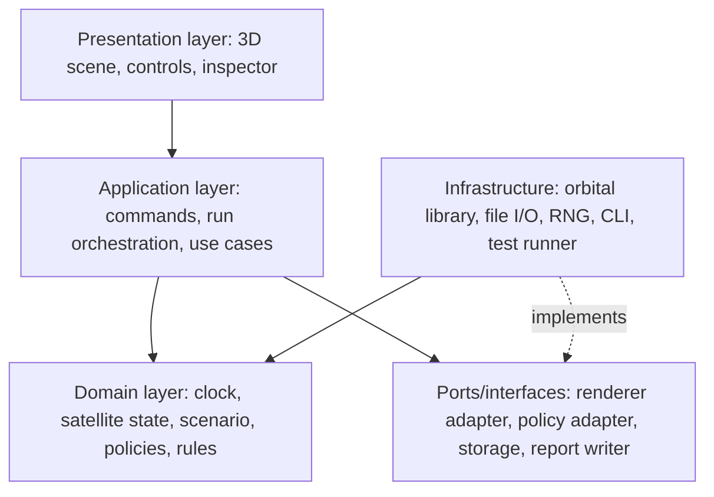
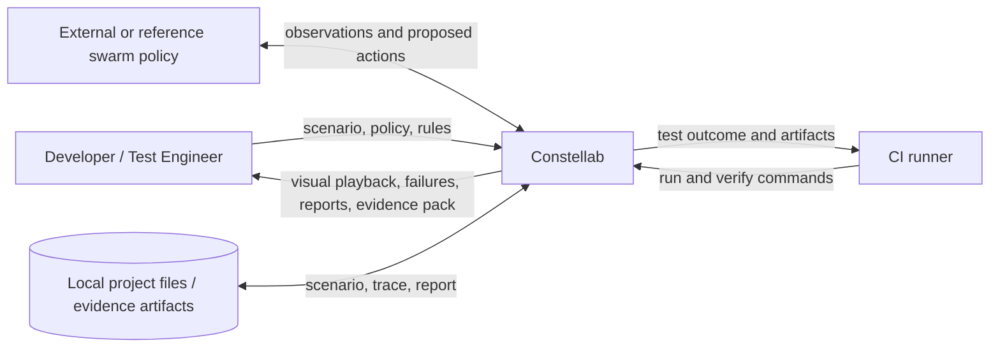
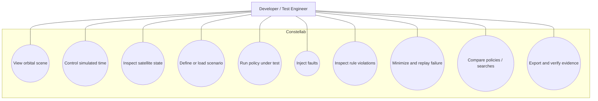
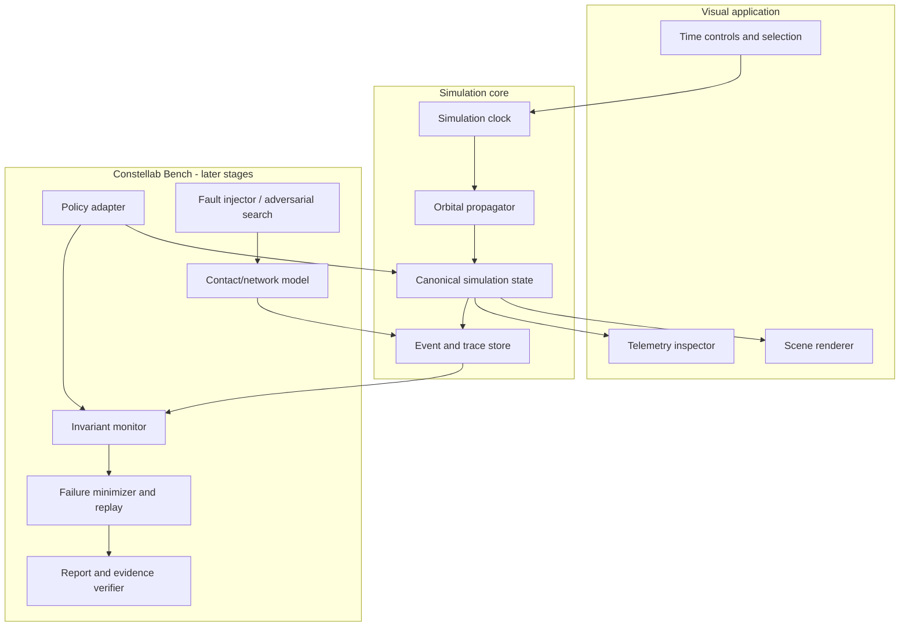
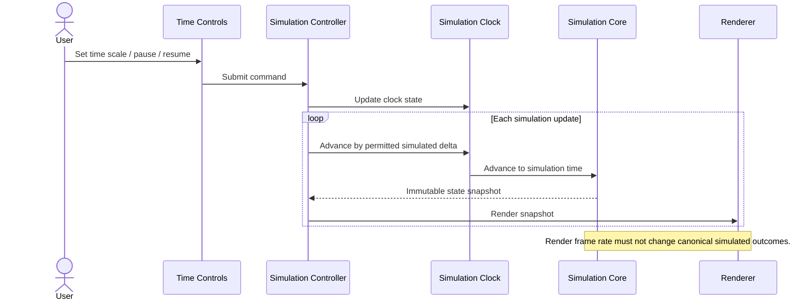
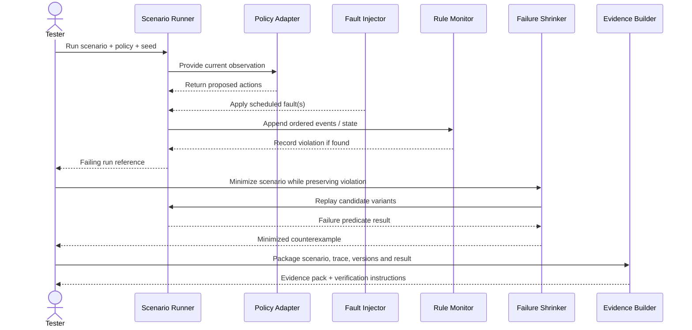
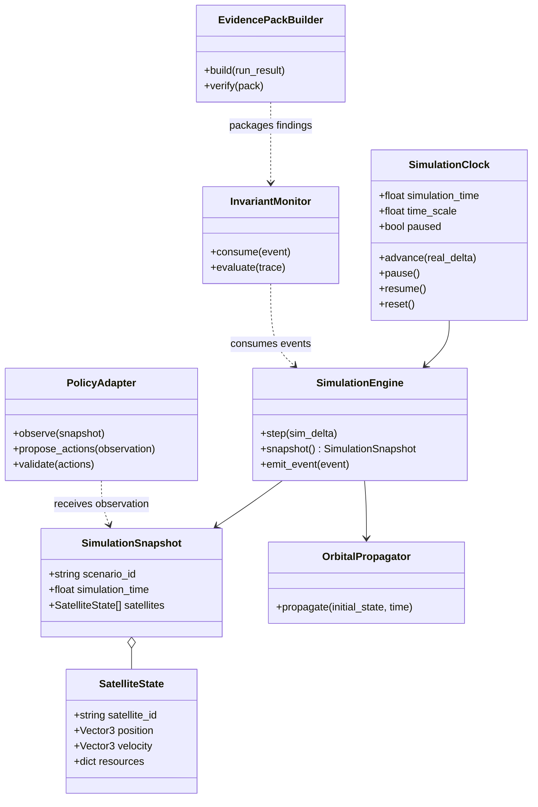
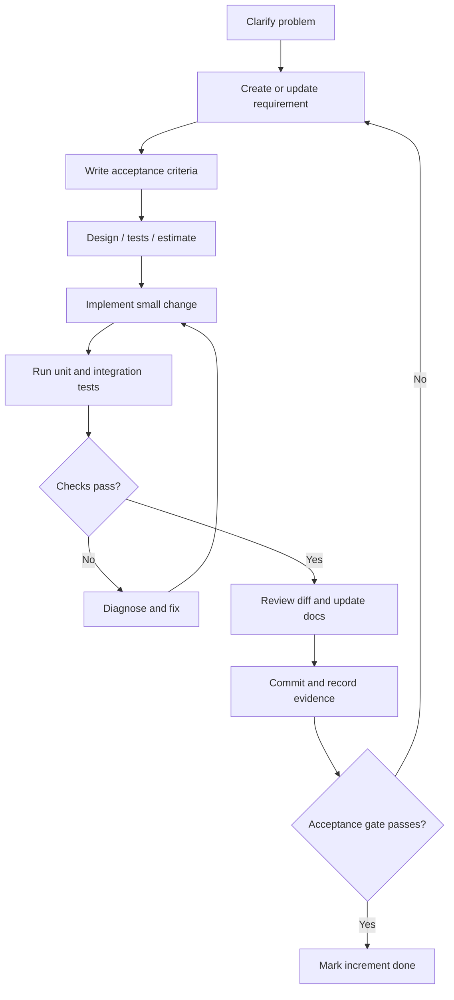
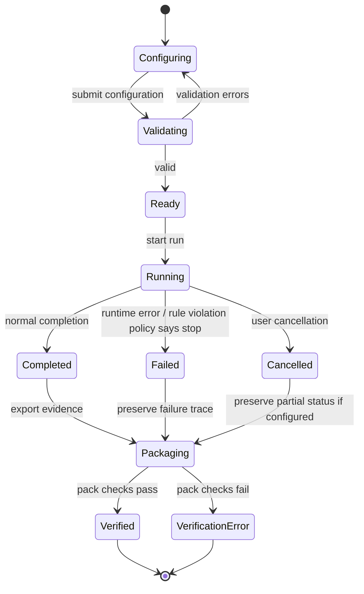
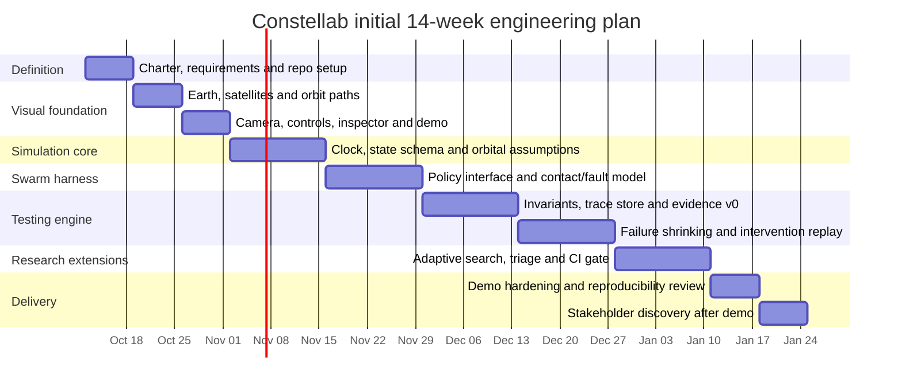

# Constellab Software Engineering Handbook

**Purpose:** Use Constellab as a real, continuously documented software-engineering project while learning and applying the topics in the attached Software Engineering syllabus.

| Document field | Value |
|---|---|
| Project | Constellab — software-only satellite-swarm autonomy testing lab |
| Document type | Engineering handbook, working project plan and syllabus application guide |
| Version | 1.0 |
| Status | Initial baseline; update through reviewed changes as the implementation teaches us more |
| Primary developer | Solo student developer |
| Intended use | Project execution, coursework practice, portfolio evidence and future research preparation |
| Project constraint | 100% software and simulation; no physical spacecraft, hardware prototype or hardware-in-the-loop requirement |

> **Working principle:** Do not merely study a concept and move on. Apply it to Constellab, create an artifact that shows the application, test that artifact, and record what you learned.

---

## How to use this handbook

This is not a claim that Constellab already implements the features below. It describes how the project should be engineered and how completion should be demonstrated. A feature is **planned** until code, tests and evidence show that it works.

For each feature, follow this loop:

1. Understand the user problem and write a requirement.
2. Define observable acceptance criteria before implementation.
3. Sketch the relevant architecture or UML model.
4. Estimate the work and identify risks.
5. Write tests; use test-driven development for logic with clear expected results.
6. Implement the smallest useful increment.
7. Run automated checks and a manual demonstration where appropriate.
8. Record the result, known limitations and any decision that changed.
9. Update the requirement-to-test traceability table.

The attached syllabus is the source for the course-topic coverage. The Constellab-specific architecture, examples and workflow below are practical applications of those topics, not additional claims about what the syllabus requires.

# Part I — Project definition and process

## 1. Product charter

### 1.1 Product vision

Constellab is a **simulation-based test lab for autonomous satellite-swarm software**. It deliberately creates difficult operating conditions, observes how a swarm policy behaves, checks configured rules, reproduces failures, reduces failures to smaller examples, investigates candidate causes and packages evidence that another person can verify.

Constellab is not primarily a visualisation dashboard. The visual orbital simulation is the first deliverable because it makes the system tangible and creates the shared state that later testing features will use. The long-term differentiator is the test workflow and quality of its reproducible evidence.

### 1.2 Engineering objectives

| ID | Objective | Evidence of completion |
|---|---|---|
| OBJ-01 | Build a useful visual orbital simulator before swarm communication or test-engine complexity | Earth, at least four moving virtual satellites, orbit paths, time controls, camera controls and satellite inspector operate from the same simulation state |
| OBJ-02 | Establish a clearly defined and repeatable simulation core | Same supported software version, configuration and seed reproduce the same canonical event trace within the documented determinism scope |
| OBJ-03 | Demonstrate a real, intentional swarm-policy failure | A documented injected fault causes a configured rule violation in a simple baseline policy; the violation appears in a trace and can be replayed |
| OBJ-04 | Make failures actionable | At least one failure can be minimized, replayed with a controlled intervention, and saved as a regression case |
| OBJ-05 | Produce checkable evidence | An evidence pack records scenario, policy/version fingerprints, test seeds, results, relevant logs and a verifier |
| OBJ-06 | Evaluate an AI/ML research extension honestly | Adaptive fault search is compared with random and/or fixed scenario search under comparable budgets, with negative results recorded too |
| OBJ-07 | Validate the direction using a tangible demo | Stakeholder conversations occur after a coherent demonstration exists; findings are recorded separately from assumptions |

These are project objectives, not promises that have already been achieved.

### 1.3 Scope

**In scope**

- A software-rendered 3D orbital scene.
- Virtual satellites, simulated time, orbit paths and inspectable telemetry.
- A documented simulation state, units, identifiers and model assumptions.
- Later, simulated communication opportunities and outages, policies, fault injection and tasking scenarios.
- Rule monitors, test runners, deterministic replay, failure minimization, counterfactual comparisons, differential/metamorphic testing and evidence verification.
- A reference policy (Fabric) only if it helps demonstrate Bench and passes its continuation decision gate.
- Automated tests, CI, documentation, reproducible experiments and honest metrics.

**Out of scope for the initial project**

- Building, buying or testing physical hardware.
- Operating real spacecraft or sending commands to a satellite.
- Claiming flight certification, mission assurance approval or guaranteed physical safety.
- A full solar-system simulator, production-grade astrodynamics for every mission, or photorealistic graphics before the test workflow works.
- Cloud infrastructure, paid hosting, federated learning or a language-model command interface before the core demonstrator is sound.
- Claims of novelty, patentability, customer demand or performance improvement without appropriate evidence.

### 1.4 Primary users and stakeholders

At the start, these are **assumed stakeholder roles**, not confirmed customers:

- **Developer (you):** implements and maintains Constellab.
- **Swarm-policy developer:** wants to test a decision-making policy against controlled failures.
- **Verification/test engineer:** wants traceable rules, reproducible defects and clear test reports.
- **Researcher or reviewer:** wants to inspect scenarios, methods, metrics and limitations.
- **Project evaluator/recruiter:** wants clear evidence of requirements, design, testing and engineering practice.

Market needs and willingness to pay remain hypotheses until validated. Per the project plan, stakeholder interviews and design-partner discussions happen only after the first end-to-end demonstration is ready.

### 1.5 Definition of Done for the whole project

A feature is not done merely because it renders once on the developer's machine. A feature is done when:

- Its requirement and acceptance criteria are recorded.
- Its implementation has a clear module boundary.
- Relevant automated tests pass.
- Related regression tests still pass.
- Errors and invalid inputs are handled deliberately.
- The documentation describes how to run and verify it.
- Known limits and assumptions are stated.
- The change is committed and its version is identifiable.

For visual features, add a manual visual check or screenshot. For stochastic experiments, include seeds, run counts, budgets and summary statistics. For evidence-generation code, test that tampering is detected and that a clean run can be verified.

## 2. Software engineering process model

### 2.1 Recommended model: iterative-incremental with stage gates

Constellab should use a **hybrid iterative-incremental process**:

- **Incremental:** deliver a small working capability at a time, such as a visible orbit scene, then telemetry, then fault injection, then failure analysis.
- **Iterative:** improve a capability after inspecting it and learning from its tests or use.
- **Risk-driven:** tackle major uncertainty early enough to avoid building on a false assumption.
- **Stage-gated:** do not move to a dependent layer until the previous layer passes its acceptance gate.
- **Agile in execution:** maintain a prioritized backlog, short planning cycles, reviews and retrospectives.

This approach fits a solo project whose scope and technical understanding will evolve. It still uses written requirements and design; Agile does not mean “no planning” or “no documentation.”

### 2.2 Compare process models for Constellab

| Model | Main idea | Strengths | Weaknesses / risks | Fit for Constellab |
|---|---|---|---|---|
| Waterfall | Requirements, design, implementation, testing and maintenance proceed mainly in sequence | Clear phase documentation and milestones | Feedback arrives late; early assumptions may be wrong | Use its documentation discipline, but not as a rigid one-pass lifecycle |
| V-model | Development phases map to corresponding test levels | Encourages test planning alongside design | Can feel rigid if requirements change often | Useful for requirements-to-test traceability and acceptance-test planning |
| Incremental | Deliver the product as usable slices | Visible progress; early working software | Poorly chosen increments can create integration debt | Strong fit for simulator-first milestones |
| Iterative | Revisit and improve prior versions | Supports learning and refinement | Can churn without a clear baseline or acceptance criteria | Useful for orbit fidelity, UI, tests and reporting improvements |
| Agile/Scrum | Prioritized backlog, timeboxed sprint, review and retrospective | Frequent feedback and transparent priorities | Ceremony can become overhead for one developer; stakeholders may be unavailable early | Use lightweight Scrum practices; hold external stakeholder interviews after the demo |
| Spiral | Repeat cycles driven by identifying and reducing major risks | Good for uncertain, high-risk technical decisions | Requires discipline; can be overcomplicated for a small project | Use risk-driven mini-cycles for determinism, failure shrinking and adaptive search |
| Big-bang/ad hoc | Start coding without agreed scope, staged plans or verification | Immediate activity | High rework and little traceability | Avoid as the project management method |

### 2.3 Lifecycle phases

1. **Inception and scope:** product charter, users, objectives, non-goals and risks.
2. **Requirements:** functional/non-functional requirements, assumptions, validation and acceptance criteria.
3. **Architecture and design:** component boundaries, key data models, UML views and architecture decisions.
4. **Implementation:** short, reviewed increments with code conventions.
5. **Verification and validation:** test against specification and check the specification still solves the intended problem.
6. **Release:** tagged version, runnable demo, documented configuration and known limitations.
7. **Operation and maintenance:** fix defects, adapt to dependencies, improve performance and prevent future defects.
8. **Process improvement:** inspect metrics and retrospectives; change the process based on evidence.

These are logical phases, not necessarily separate long calendar blocks. Requirements, design, implementation and testing recur within each increment.

### 2.4 Agile practice for a solo developer

Use a two-week planning horizon for main milestones, but deliver smaller increments inside it. Each sprint should include:

- **Sprint planning:** choose the goal, select ready backlog items, split tasks and estimate effort.
- **Daily check-in (self-review is sufficient):** What changed? What is next? What is blocked?
- **Review:** run the acceptance demo and compare the result with the sprint goal.
- **Retrospective:** identify one process improvement, one thing to retain and one issue to address.
- **Backlog refinement:** clarify future tasks and dependencies without promising to implement everything.

Do not perform ceremonial meetings for their own sake. Preserve the purpose: shared understanding, short feedback loops and visible risks.

### 2.5 Example sprint-planning exercise: first visual increment

**Sprint goal:** an outsider can launch Constellab, view Earth and four moving satellites, control simulated time, select a satellite and read its telemetry.

| Backlog item | Acceptance criteria | Priority | Estimate (illustrative) |
|---|---|---|---:|
| Create application scaffold | Clean install instructions run successfully | Must | 3 points |
| Define simulation snapshot | IDs, time, coordinate convention and units are documented and validated | Must | 3 points |
| Render Earth and satellites | Four distinct satellite markers render from snapshot data | Must | 3 points |
| Animate simulation time | Pause, resume, reset and time scale affect simulated time—not physics based on render frame rate | Must | 5 points |
| Draw orbit paths | Paths are labelled as visualized model orbits and align with satellite state | Must | 5 points |
| Select satellite / inspector | Selection displays the state of the selected satellite and updates when simulation advances | Should | 3 points |
| Capture demo | Short recording and clean-start checklist are committed | Should | 1 point |

These estimates are examples, not a forecast derived from historical velocity. Re-estimate after the first sprint using actual data.

### 2.6 Example lightweight Scrum check-in

- **Yesterday:** Implemented the satellite-state schema and static Earth scene.
- **Today:** Connect the time controller to the canonical simulation clock and add a deterministic test.
- **Blocker/risk:** The renderer currently computes positions independently, which could cause the visual state and simulation state to diverge.
- **Action:** Move position calculation behind the simulation-state interface before adding more visual effects.

The point is to expose blockers early, not to produce a long status report.

# Part II — Requirements engineering

## 3. Requirements management

### 3.1 Why requirements engineering matters

Requirements turn “make Constellab cool” into observable behavior that can be designed, implemented and tested. It limits scope creep, lets us decide what to build first, and provides traceability from a stakeholder need to code and test evidence.

A requirement should describe **what** the system must do or a constraint it must satisfy. Design describes **how** we will satisfy it. For example:

- Requirement: “The user can pause simulated time without losing the current satellite selection.”
- Design choice: “A `SimulationClock` owns pause state; a `SceneController` subscribes to snapshots.”

### 3.2 Elicitation techniques and how Constellab uses them

| Technique | What it means | Constellab application |
|---|---|---|
| Document analysis | Study existing source material, constraints and standards | Use the product briefing, syllabus and known simulator/policy interfaces as inputs; record where they disagree |
| Interviews | Ask potential users structured questions | After the demo, ask swarm developers and test engineers how they currently reproduce and report defects |
| Observation/contextual inquiry | Observe a person performing a task | If a design partner agrees, watch how they create a scenario, diagnose a failure and prepare a report |
| Workshops | Resolve terminology and priorities together | Use a short requirements-review session after showing the demo |
| Brainstorming | Generate possible ideas before filtering | Use it for possible injected faults or reporting features, not as a substitute for validation |
| Prototyping | Make a limited artifact to clarify requirements | The first visual simulator is a prototype and product increment; ask whether the state and controls are understandable |
| Surveys | Collect structured feedback from multiple respondents | Consider only when there is a sufficiently defined audience and specific questions |
| Interface analysis | Examine how a system might connect to another | Define a narrow policy adapter and test it with a simple reference policy before supporting multiple integrations |

During early development, the developer is a proxy stakeholder. Mark assumed needs as **assumptions** and avoid treating them as customer-confirmed requirements. The project intentionally delays market interviews until a usable demo exists.

### 3.3 Requirement types

- **Functional requirement (FR):** a capability or behavior, such as rendering a satellite or running a seeded test.
- **Non-functional requirement (NFR):** a quality or constraint, such as reproducibility, usability, performance or maintainability.
- **Constraint:** a boundary imposed on the project, such as software-only simulation.
- **Assumption:** a statement temporarily believed to be true but not yet validated.
- **Acceptance criterion:** a condition that can be checked to decide whether a requirement is satisfied.

Do not put vague words like *fast*, *robust*, *secure*, *realistic* or *easy* in a requirement without making them measurable or describing how they will be evaluated.

### 3.4 Initial functional requirements baseline

The IDs below are a starting point. Change them through documented change control; do not silently renumber requirements referenced by tests or reports.

| ID | Requirement | Priority | Acceptance evidence |
|---|---|---|---|
| FR-001 | Constellab shall render an Earth model and at least four virtual satellites in a 3D scene. | Must | Manual visual check plus a scene smoke test |
| FR-002 | Satellite positions shown in the scene shall be derived from the canonical simulation state. | Must | Integration test compares rendered position inputs with the state snapshot |
| FR-003 | The user shall be able to pause, resume, reset and change simulated-time scale. | Must | UI test and unit tests for clock transitions |
| FR-004 | The user shall be able to select a satellite and inspect its identifier and available telemetry. | Must | UI interaction test |
| FR-005 | A scenario shall define reproducible starting conditions and record its configuration/version. | Must | Schema validation test and saved run metadata |
| FR-006 | A run shall produce an ordered event trace. | Must, after visual base | Trace ordering and trace replay tests |
| FR-007 | A policy shall receive a documented observation and return validated actions through a stable interface. | Must, after visual base | Contract tests with valid and invalid policy responses |
| FR-008 | Constellab shall model communication opportunities and configurable interruptions only after the orbital foundation is accepted. | Must, later | Contact model tests and outage scenario |
| FR-009 | A fault injector shall support reproducible random and targeted faults with recorded parameters. | Must, later | Same seed/config produces same fault schedule within defined scope |
| FR-010 | Rule monitors shall report invariant violations with timestamps and trace references. | Must, later | Positive and negative tests for every rule |
| FR-011 | A failing scenario shall be reducible while preserving the selected failure predicate. | Should | Shrunk scenario still reproduces the target violation |
| FR-012 | The investigation workflow shall compare baseline and controlled-intervention replays. | Should | Paired traces, explicit changed variable, controls and cautious conclusion |
| FR-013 | A run shall support an evidence pack with configuration, versions, results and verification instructions. | Must for demo | Clean-checkout verification succeeds; edited records are detected |
| FR-014 | Adaptive search shall record its candidate-generation strategy, budget, seeds and outcomes. | Research extension | Search results replay from recorded candidates |
| FR-015 | Constellab shall compare selected policies against the same scenarios and budgets. | Should | Comparison output documents matched conditions and differences |
| FR-016 | The command-line workflow shall return a clear non-zero exit status for configured verification failures. | Should | CLI integration test |
| FR-017 | The system shall preserve a confirmed failing scenario as a regression case. | Should | Regression reproduces before fix and passes or changes as expected after fix |
| FR-018 | Failure reports shall distinguish confirmed observations from inferred causes. | Must for credible reports | Report schema and wording tests / reviewer checklist |

### 3.5 Initial non-functional requirements baseline

| ID | Quality attribute | Initial requirement / acceptance method |
|---|---|---|
| NFR-001 | Reproducibility | In the documented supported environment, identical scenario version, policy version, configuration and seed reproduce the same canonical trace hash. State any cross-platform floating-point limitations. |
| NFR-002 | Correctness | Each built-in rule has tests for at least one violating case and one compliant case; important boundary cases are included. |
| NFR-003 | Usability | A new developer following the README can launch the visual demo using the documented clean setup process; usability claims must be validated, not assumed. |
| NFR-004 | Maintainability | Simulation logic, rendering, policy adapters and reporting are separate modules with documented interfaces. |
| NFR-005 | Performance | Record runtime and memory for a declared workload. Set targets after an initial baseline instead of inventing unsupported speed claims. |
| NFR-006 | Portability | Pin supported runtime/dependency versions and test on the declared primary OS; widen support only after CI covers it. |
| NFR-007 | Integrity | The verifier detects changes to evidence records; signatures are used when authenticity is required. A hash chain alone does not establish who generated the file. |
| NFR-008 | Observability | Runs record enough structured events to explain a failure without relying only on console output. |
| NFR-009 | Security | Validate scenario and policy inputs, minimize secrets, pin dependencies where feasible and review plugin execution boundaries. |
| NFR-010 | Extensibility | A new policy should implement the documented adapter contract without editing the simulation core. |

Targets may be made more specific when a baseline is available. Any revised numeric target should include the reason and measurement method.

### 3.6 Requirement quality checklist

For each requirement, ask:

- Is it necessary for the defined product goal?
- Is it unambiguous and stated from the system/user perspective?
- Can it be tested or inspected?
- Is it feasible in the current scope?
- Does it conflict with another requirement?
- Is its priority and dependency known?
- Is there an acceptance criterion?
- Is there at least one planned test or validation activity?

### 3.7 Requirement validation and ambiguity exercise

**Weak statement:** “The simulation should be realistic and fast.”

**Problems:** “realistic” is undefined; “fast” has no workload; no boundary or measurement method is given.

**Improved examples:**

- “For the declared four-satellite demonstration scenario, the simulation shall advance using simulated time independent of display frame rate.” Test by running the same duration with different render frame rates and comparing canonical snapshots.
- “The orbit model and its limitations shall be visible in the documentation and included in run metadata.” Test by inspecting the scenario and report schema.
- “For workload W on the documented reference environment, N seeded L0 runs shall complete within target T.” Set W, N and T only after benchmarking and agreeing on the target.

**Peer review exercise:** have another person highlight ambiguous terms, missing assumptions, hidden implementation choices and requirements without acceptance criteria. If no peer is available yet, perform a written self-review using the checklist and record it as self-review, not independent review.

### 3.8 Requirements traceability matrix

Keep a file such as `docs/requirements/traceability.csv` with columns:

`Requirement ID, requirement version, design component, implementation path, test IDs, status, evidence location, known limitation`.

Example:

| Requirement | Design / component | Test(s) | Current status |
|---|---|---|---|
| FR-003 time controls | `SimulationClock`, `TimeControlPanel` | `UT-CLOCK-*`, `UI-TIME-*` | Planned until tests/code exist |
| NFR-001 reproducibility | seeded RNG, canonical event serializer | `DET-001`, `DET-002` | Planned |
| FR-010 rule violations | `InvariantMonitor` | `INV-*` | Planned |

A requirement cannot be marked complete merely because a code module exists; link its acceptance evidence.

### 3.9 Change control

When a requirement changes:

1. Describe the requested change and why it is needed.
2. Identify affected requirements, architecture, tests, schedule and risks.
3. Estimate the impact and decide whether to accept, defer or reject it.
4. Update the baseline and traceability matrix.
5. Implement and test the change in a small increment.
6. Record the decision in a short Architecture/Scope Decision Record.

# Part III — Architecture and design

## 4. Architecture strategy

### 4.1 Architecture style

Start with a **modular monolith**: one project and one local workflow with clean internal boundaries. Do not split the project into network services merely to use a client-server architecture. A local client-server boundary may be introduced later if the renderer and simulation core need separate processes or an external policy must be called.

Use a layered design to keep responsibilities separate, and use MVC-like separation in the user interface. The rendering layer must display the simulation state, not invent its own independent physics.

### 4.2 Logical layers



**Layer responsibilities**

- **Presentation:** drawing, input, selection, labels and visual status. It must not own authoritative orbital state.
- **Application:** sequences user actions such as start, pause, run scenario, compare policies and verify evidence.
- **Domain:** simulation clock, state transitions, rules, scenario semantics and policy contracts. Keep it testable without a graphical window.
- **Ports/interfaces:** stable contracts to decouple the core from a specific renderer, policy runtime or storage implementation.
- **Infrastructure:** actual file readers/writers, selected orbital calculations, deterministic RNG, CLI and reporting adapters.

The diagram is a logical view, not an assertion that every layer must be a separate process or deployable service.

### 4.3 MVC for the visual application

- **Model:** canonical simulation snapshot, satellite states, scenario, clock and selected-satellite state.
- **View:** Earth, satellite markers, orbit lines, labels, inspector panel and time controls.
- **Controller:** user input handlers that issue commands such as pause, select satellite or change time scale.

Do not let the view directly mutate orbital parameters. A control issues a command to the application/domain layer; the simulation produces a new snapshot; the view renders that snapshot.

### 4.4 Client-server architecture: when to use it

The current default is local execution. If a later policy runs in a separate process, use a documented request/response contract or local IPC. If future hosted execution is added, a client-server design may separate UI/API, job scheduler, workers and artifact storage.

A client-server design introduces serialization, versioning, latency, authentication and failure modes. Do not add it before an actual requirement justifies it. If used, version the API and keep the deterministic run configuration independent of the transport.

### 4.5 Design principles

- **Separation of concerns:** rendering is not physics; reporting is not simulation; search does not rewrite the evaluator.
- **Single responsibility:** each module should have one primary reason to change.
- **Explicit contracts:** define accepted inputs, outputs, errors and invariants.
- **Dependency inversion:** domain logic depends on interfaces rather than a concrete renderer or file system.
- **High cohesion, low coupling:** related behavior belongs together; unrelated behavior communicates through narrow interfaces.
- **Composition over inheritance:** prefer assembling a policy, clock, simulator and monitor over deep class hierarchies.
- **Fail clearly:** reject malformed scenarios and invalid actions with actionable messages.
- **Determinism first:** record sources of randomness and sort data that affects canonical outputs.
- **Make invalid states difficult to represent:** use validated types and constructors where practical.
- **Do not over-engineer:** simple functions are appropriate when classes or patterns add no value.

### 4.6 Patterns to apply deliberately

| Pattern | Constellab use | Caution |
|---|---|---|
| MVC | Split visual state/model, view and user input handling | Avoid duplicating the simulation state in the view |
| Strategy | Swap greedy, auction, leases-only, Fabric and search strategies through a common interface | Keep the common contract narrow and test every implementation against it |
| Adapter | Connect a policy or rendering implementation to the core interface | Validate data crossing the boundary |
| Observer / event subscription | Update visual components when a new snapshot/event arrives | Avoid hidden ordering dependencies in deterministic runs |
| Command | Represent user actions and controlled interventions as explicit values | Record the exact command/configuration used in a run |
| Factory | Create validated scenario/policy instances from configuration | Never dynamically load arbitrary untrusted code by default |
| Repository (where useful) | Read/write scenarios, traces or evidence through a defined interface | Do not wrap simple file I/O unnecessarily |

Do not use a pattern because it appears in a syllabus. Use it because it solves a real coupling, testability or extensibility problem.

## 5. Design models and UML

Maintain diagrams as source in `docs/architecture/diagrams/`. Mermaid diagrams render in many Markdown viewers and can be version-controlled. Each diagram should answer a specific design question and be updated when the design changes materially.

### 5.1 System context diagram

This is the highest-level view: who/what interacts with Constellab and what goes across the boundary.



For the initial visual milestone, the external policy, test-engine and CI interactions are not yet implemented. The diagram describes the intended system boundary, not the initial build.

### 5.2 Use-case model



### 5.3 Component / structural view



### 5.4 Sequence diagram: visual simulation tick



### 5.5 Sequence diagram: future fault-to-evidence workflow



### 5.6 Class / object-oriented design view



These are logical classes, not a requirement that every box must be a Python class. Use functions and immutable data structures where simpler.

### 5.7 Activity diagram: release a feature



### 5.8 Behavioral state machine: run lifecycle



### 5.9 UI wireframe for the first milestone

The first visual UI should be functional and restrained. A rough wireframe is enough to agree on layout before polishing it.

```text
+--------------------------------------------------------------------------------+
| Constellab     [Play/Pause] [Reset] [Time scale: 1x v]   Sim time: 00:12:34        |
+--------------------------------------------+-----------------------------------+
|                                            | SELECTED SATELLITE                 |
|                                            | ID: SAT-01                         |
|             3D ORBITAL SCENE               | Orbit model: documented L0/L1     |
|                                            | Position: x / y / z                |
|     Earth + satellite markers + paths      | Velocity: x / y / z                |
|                                            | Model assumptions                  |
|                                            |                                   |
+--------------------------------------------+-----------------------------------+
| STATUS: simulation running | 4 satellites | Model fidelity: stated in UI     |
+--------------------------------------------------------------------------------+
```

Usability acceptance criteria for the first version:

- Controls have explicit labels and visible state.
- Selection is visually distinguishable and the inspector corresponds to the selected satellite.
- Units and model assumptions are not hidden behind unexplained numbers.
- The UI remains usable at the declared target window size.
- A visible orbit path is described as the modeled orbit, not a guarantee of precise flight prediction.

### 5.10 Architecture decision records (ADRs)

Store decisions in `docs/architecture/adr/ADR-NNN-title.md` using this template:

```text
# ADR-NNN: Short title
Status: Proposed / Accepted / Superseded
Date:
Context: What problem or decision is present?
Decision: What did we choose?
Alternatives: What else was considered?
Consequences: Benefits, costs, risks and limitations.
Evidence / revisit trigger: What would cause us to reconsider?
```

Suggested early ADRs:

- ADR-001: Single canonical simulation state.
- ADR-002: Renderer does not own orbital calculations.
- ADR-003: Initial simulation model and its documented fidelity.
- ADR-004: Determinism scope and random-number generator policy.
- ADR-005: Local modular monolith before any client-server split.
- ADR-006: Scenario format and schema versioning.

# Part IV — Testing and software evolution

## 6. Testing philosophy and plan

### 6.1 Why test at multiple levels?

No single test type can reveal every defect. Unit tests check small logic; integration tests check boundaries; system tests check the running product; acceptance tests check whether the product satisfies the intended need. Black-box and white-box are complementary approaches, not competing choices.

A **test plan** explains what will be tested, why, how, where, by whom, with what data, and what counts as acceptable. Keep `docs/testing/test-plan.md` current as the project changes.

### 6.2 Testing scope by stage

**Stage A — visual foundation**

- Simulation clock and time-scale unit tests.
- State-schema and input validation tests.
- Orbital-state / propagator unit tests for the chosen model.
- UI integration tests for pause, resume, reset, select and inspector.
- Visual smoke test or screenshot checklist.
- Regression test proving renderer frame rate does not alter canonical simulation-time results.

**Stage B — swarm and network model**

- Contact-window / link-availability tests.
- Policy-adapter contract tests.
- Fault-schedule determinism tests.
- Duplicate-tasking and resource-rule tests.
- Integration tests for policy, simulated network and event trace.

**Stage C — testing engine**

- Rule monitors, failure predicate and event trace tests.
- Shrinker tests for failure preservation and declared minimality scope.
- Counterfactual replay tests with negative controls.
- Differential/metamorphic tests.
- Evidence integrity and clean-checkout verification tests.
- Search strategy comparison tests and experiments.

### 6.3 Test levels

| Level | Purpose | Constellab example |
|---|---|---|
| Unit | Test a small function or class in isolation | Pause/resume logic; deterministic tie-breaker; hash serialization |
| Component | Test a module and its immediate contract | Orbital propagator plus state builder |
| Integration | Check modules work together | Clock advances core state and renderer consumes the same snapshot |
| System/end-to-end | Test the complete user flow | Launch app, select satellite, run a fault scenario, export and verify an evidence pack |
| Acceptance | Decide whether the user need is met | A clean checkout can reproduce the documented failure-to-evidence demo |
| Regression | Ensure a fix does not reintroduce an old defect | Previously failing duplicate-tasking scenario remains in CI |
| Exploratory | Discover issues not covered by existing scripts | Vary window size, time scale and rapid pause/resume sequences |
| Performance/load | Check declared workloads and resource use | Run N scenarios and record throughput, peak memory and p95 runtime |
| Reliability/soak | Look for degradation across prolonged use | Run repeated simulations and verify no unexplained memory/resource growth |

### 6.4 Black-box testing

Black-box testing derives tests from requirements and externally observable behavior, without relying on implementation details.

**Technique A — equivalence partitioning**

Split inputs into groups expected to behave similarly, then select representative values.

Example: a time-scale control accepts a documented valid interval.

- Valid partition: values inside the supported interval.
- Invalid partition: values below the minimum, above the maximum, non-numeric values and missing values.
- Boundary partition: exact minimum and maximum.

The actual supported range must be defined in requirements before writing expected outcomes.

**Technique B — boundary-value analysis**

Test just below, at and just above a boundary. For a chosen interval `[min, max]`, test `min - ε`, `min`, a normal interior value, `max`, and `max + ε`. For integer-only controls, use neighboring integers.

**Technique C — decision-table testing**

For a future policy action admission rule, test combinations such as valid/invalid action, sufficient/insufficient energy margin, current/expired lease and available/unavailable link. Each row should specify the expected result.

**Technique D — state-transition testing**

Test legal and illegal transitions: `Paused → Running`, `Running → Paused`, `Running → Cancelled`, `Completed → Running` (whether allowed or rejected must be specified), and `Reset → initial state`.

#### Example black-box test cases

| Test ID | Requirement / behavior | Input or setup | Expected result |
|---|---|---|---|
| BB-CLOCK-001 | Resume a paused simulation | State `Paused`, issue Resume | Clock is Running and advances only according to the configured time scale |
| BB-CLOCK-002 | Pause simulation | State `Running`, issue Pause | Simulation time stops advancing |
| BB-CLOCK-003 | Reset simulation | Advance, then Reset | Clock and selected scenario state return to their documented initial values |
| BB-UI-001 | Select satellite | Click SAT-02 marker | Inspector reports SAT-02, not a stale prior selection |
| BB-INPUT-001 | Reject malformed scenario | Missing required field or invalid type | Validation error identifies the field; run does not start |
| BB-TRACE-001 | Replay a seeded run | Same version/config/seed twice | Canonical event traces match within declared reproducibility scope |
| BB-EVID-001 | Detect altered evidence | Edit one record in an exported pack | Verifier reports integrity failure |

### 6.5 White-box testing

White-box testing derives tests from internal logic or code structure. Use it for functions with branches, error paths or safety-relevant decisions.

- **Statement coverage:** each executable statement has been run by tests.
- **Branch coverage:** each decision outcome, such as true and false, has been exercised.
- **Condition coverage:** each Boolean condition has been independently shown true and false where practical.
- **Path testing:** exercise important execution paths, while recognizing that all paths may be infeasible or too numerous.
- **Error-path testing:** ensure malformed configuration, rejected actions and failed writes produce controlled outcomes.

Coverage is evidence about which code was exercised, not proof the code is correct. Set practical targets for critical modules after obtaining baseline coverage. Favor strong tests over pursuing a percentage by adding assertions without meaningful expected results.

For `admit_action`, for example, test a state where every margin passes, a state where each individual margin fails, a boundary exactly at the allowed floor, missing resource information and invalid numeric values.

### 6.6 Test-driven development (TDD)

Use the Red → Green → Refactor loop:

1. **Red:** write a small test for behavior that is not implemented; confirm it fails for the expected reason.
2. **Green:** write the smallest implementation that makes it pass.
3. **Refactor:** improve names and structure without changing behavior; rerun the suite.

#### Small TDD exercise: deterministic time controller

Define the rule first: advancing by a simulated delta should not change state when paused; when running, the simulated clock advances according to an explicitly defined time-scale policy. The policy for negative delta and excessive scale must be documented.

Illustrative `pytest` sketch (adapt module names to the implementation):

```python
def test_paused_clock_does_not_advance():
    clock = SimulationClock(simulation_time=10.0, time_scale=1.0, paused=True)
    clock.advance(real_delta=2.0)
    assert clock.simulation_time == 10.0


def test_running_clock_uses_configured_scale():
    clock = SimulationClock(simulation_time=10.0, time_scale=4.0, paused=False)
    clock.advance(real_delta=2.0)
    assert clock.simulation_time == 18.0


def test_negative_real_delta_is_rejected():
    clock = SimulationClock(simulation_time=10.0, time_scale=1.0, paused=False)
    with pytest.raises(ValueError):
        clock.advance(real_delta=-1.0)
```

This sketch defines one possible clock contract. Before coding it, explicitly decide whether negative deltas are rejected, how values are clamped and what floating-point tolerance is appropriate. Then implement the smallest code that satisfies the tests.

### 6.7 Regression testing

Every confirmed defect should produce a minimized, reproducible scenario or a smaller unit/integration test. After the fix:

1. Demonstrate that the old test fails against the buggy version if that version is available.
2. Demonstrate that it passes against the fix.
3. Run all relevant regression tests.
4. Record any changed behavior that is intentional.
5. Keep the failing scenario and its expected outcome in version control unless it contains sensitive user-provided material.

A green build means the chosen tests passed. It does not mean every possible defect has been eliminated.

### 6.8 Property-based testing

Instead of listing only hand-picked examples, generate many inputs from defined domains and check general properties. This is especially suitable for merges, serializers, clocks, scenario validation and deterministic tie-breaking.

Possible properties:

- Merging the same fact set twice has the same result as merging it once (idempotence), if the merge design promises that law.
- Reordering independent scenario declarations should not alter canonical outcomes, if declaration order is specified as irrelevant.
- A serialized and then parsed valid scenario preserves its canonical meaning.
- The same scenario version, seed and policy version reproduce the canonical trace in the supported environment.
- A shrinker never reports a minimized counterexample unless the selected failure predicate still reproduces.

Property tests need explicit assumptions and bounded input strategies. Do not assert a property that the system design does not promise.

### 6.9 Differential and metamorphic testing

**Differential testing:** compare two implementations or policies on the same input and examine discrepancies. Example: compare two implementations of a simple orbit propagator over a documented valid domain, or compare policy behavior under identical scenarios.

**Metamorphic testing:** where no simple expected output is available, define a transformation that should preserve or predictably change the result.

Potential Constellab relations:

- Renaming satellite IDs consistently should preserve physical results while correspondingly renaming IDs in output.
- Reordering independent configuration fields should not change canonical behavior.
- Replaying an existing scenario should not create new event types or unexplained state changes.
- Increasing display frame rate while holding simulated time steps constant should not alter the canonical trace.

Each relation must be justified. Do not assume rotation of coordinate axes, scaling an orbit or changing time steps preserves outputs unless the underlying model and transformation establish it.

### 6.10 AI-based and automated testing

AI is a **test assistant and candidate generator**, not the source of truth for pass/fail results.

Planned AI/ML uses, in increasing complexity:

1. **Scenario mutation:** change fault timings, link pairs, delays, outage duration or satellite failure time within a validator-defined domain.
2. **Guided search:** prioritize candidates that trigger new failure signatures or reach previously unexplored states.
3. **Failure clustering:** propose groups of similar traces for human review.
4. **Report summarization:** draft a plain-language explanation from structured, verified data.
5. **Test generation assistance:** suggest edge cases that a developer then reviews and converts into deterministic regression tests.

Required guardrails:

- The evaluator, invariants and final verifier remain deterministic and independently tested.
- AI-generated scenarios are validated before execution.
- Record model/version, prompt/configuration where appropriate, candidate seed, search budget and outcome.
- Do not allow an AI agent to edit the rules it is being evaluated against without explicit review and versioned change control.
- Test on held-out scenario families to reduce overfitting.
- Compare with random search and fixed scenarios using equal or transparently reported budgets.
- Report false positives, repeated failures, runtime and failures that were not reproduced.
- A generated explanation is a hypothesis until confirmed by trace inspection and controlled replay.

### 6.11 Test environment and data management

Record in each run:

- Constellab commit/version and dependency lockfile fingerprint.
- Scenario ID and schema version.
- Policy name/version and code fingerprint where permitted.
- Random seed(s) and RNG method.
- Model fidelity, time step, units and relevant simulation assumptions.
- Test configuration, fault schedule, run budget and hardware/software environment where performance results are reported.
- Start/end status, violations, warnings and output artifact checksums.

Use synthetic scenarios by default. If external data or third-party policy code is ever introduced, record its license, provenance, permitted use and handling requirements.

### 6.12 Test reporting and defect lifecycle

A defect record should contain:

- Unique defect ID and title.
- Severity and priority (these are different: severity describes impact; priority describes when it should be fixed).
- Affected version and requirement IDs.
- Preconditions, exact scenario, seed and reproduction command.
- Expected behavior versus actual behavior.
- Minimal trace/counterexample and attachments.
- Candidate cause versus confirmed cause.
- Fix commit, regression test and verification result.

Suggested lifecycle: `New → Triaged → In Progress → Fixed → Verified → Closed`. Reopen a defect if the fix fails or a regression reappears. Not every issue needs a complex workflow; the status should make the next action obvious.

## 7. Software maintenance, reuse and reengineering

### 7.1 Maintenance types

| Type | Meaning | Constellab example |
|---|---|---|
| Corrective | Fix a discovered defect | Correct a bug where reset retains stale selected-satellite data |
| Adaptive | Change software for a changed environment or dependency | Update the renderer integration for a new supported runtime version |
| Perfective | Improve capability, usability or performance | Improve timeline filtering or reduce memory used by traces |
| Preventive | Reduce future failure probability or maintenance cost | Refactor duplicated validation and improve dependency/security checks |

### 7.2 Legacy systems and technical debt

A legacy system is not simply an old system; it is often a system whose structure, dependencies or knowledge make change difficult, even if it still provides value. Constellab will eventually develop technical debt too.

Warning signs include duplicated simulation logic, unclear units, tests that depend on test order, unpinned dependencies, hidden global state, policies that inspect private simulator internals, and evidence artifacts that cannot be replayed.

When an existing component becomes hard to modify:

1. Establish current behavior with characterization tests.
2. Record the interface and constraints.
3. Identify the smallest safe seam for replacement.
4. Build a replacement behind the same interface.
5. Compare old and new behavior over a controlled corpus.
6. migrate in steps and retain a rollback path.

### 7.3 Reuse versus reengineering

| Choice | Use when | Main risk to control |
|---|---|---|
| Reuse a library | It solves a well-defined problem and its license, quality and API suit the project | Hidden assumptions, API churn, security or license mismatch |
| Wrap with an adapter | You want a stable Constellab interface around a third-party implementation | The adapter can become a thin wrapper that does not actually isolate differences |
| Reengineer an existing module | The current implementation is difficult to test or violates a core requirement | Rewrite may lose undocumented behavior; add characterization tests first |
| Replace wholesale | The module is small, bounded and the cost of preserving it exceeds migration cost | High regression risk; compare behavior before deleting the old path |

Do not rewrite a working module purely for stylistic reasons. Evaluate improvement, migration risk, testability, license and maintenance cost.

# Part V — Project planning and risk management

## 8. Planning and estimation

### 8.1 Work breakdown structure

Use this top-level WBS; split each item into tasks small enough to implement and verify independently.

1. **Project governance:** charter, backlog, requirements, risk register, ADRs, versions and release notes.
2. **Visual simulator:** application scaffold, state schema, Earth, satellites, orbit paths, camera, controls, inspector and visual demo.
3. **Simulation core:** time, coordinate conventions, orbit model, deterministic configuration and telemetry timeline.
4. **Swarm test harness:** policy interface, observations/actions, event trace and baseline policies.
5. **Fault model:** contact opportunities, random faults, targeted outages and node/sensor faults.
6. **Verification engine:** invariant checks, temporal rules, test runner and violation reports.
7. **Failure investigation:** shrinking, controlled interventions, differential/metamorphic tests and triage.
8. **Research extension:** adaptive adversarial search, metrics and benchmark suite.
9. **Evidence and delivery:** evidence pack, hashing/signatures, verifier, CLI, CI and demo packaging.
10. **Evaluation and evolution:** stakeholder validation after demo, process review, next-stage backlog.

### 8.2 Estimation with story points

Story points express **relative effort/complexity/uncertainty**, not hours. A Fibonacci-like scale such as 1, 2, 3, 5, 8, 13 is useful because estimates are approximate.

Estimate by comparing a new task with a completed reference task. A task that spans multiple subsystems or has unresolved design uncertainty should usually be split or investigated before it receives a confident estimate. Do not compare story points between teams as if they were a universal unit.

After two or three increments, calculate your own observed velocity: accepted points completed per sprint. Treat it as a planning aid, not a performance target. Do not inflate estimates or weaken acceptance criteria to increase velocity.

### 8.3 Use Case Points (UCP) as an alternate estimation technique

If coursework requires Use Case Points, estimate actors and use cases by complexity, then apply documented technical and environmental adjustment factors using one consistent method:

`UCP = (Unadjusted Actor Weight + Unadjusted Use Case Weight) × Technical Complexity Factor × Environmental Factor`

The exact actor/use-case weights and adjustment-factor ranges should follow the method taught in your course and be recorded. A productivity factor is then needed to turn UCP into effort; calibrate it from comparable work where possible. For a solo project with no historical dataset, label the result a rough estimate and give a range rather than pretending the number is exact.

Story points are the practical default for the backlog; UCP can be completed as a coursework exercise and compared against observed delivery. Do not combine the two methods into a single unexplained number.

### 8.4 Estimation workflow

1. Define the deliverable and acceptance criteria.
2. Break work into implementation, tests, documentation and integration tasks.
3. Identify dependencies and unknowns.
4. Estimate using the chosen method.
5. Add risk-adjusted contingency to milestones with genuine uncertainty; state why.
6. Compare estimate with actuals after completion.
7. Update the technique based on observed error.

### 8.5 Gantt-style project schedule (initial baseline)

The following 14-week schedule is the current planning target. It is not a guarantee. The gate must pass before the project advances, even if that moves the calendar.



The dates are an illustrative baseline anchored to the handbook's preparation date and should be reset when the actual start date changes. The dependency order matters more than the calendar labels.

### 8.6 Stakeholder outreach timing

Do not make external outreach a prerequisite for the first two months of implementation. First build a visible orbital simulator, then a reproducible test failure and a clear evidence pack. After the stakeholder-ready gate, conduct a small number of targeted conversations to evaluate whether the problem is real, how the proposed workflow compares with existing approaches, what evidence users require and what integration boundary would be useful.

Record interviews without overstating them. Distinguish direct quotes/observations, your interpretation, unresolved questions and resulting product decisions. Do not claim market validation merely because someone says the idea sounds interesting.

## 9. Risk management plan

### 9.1 Risk process

A risk is an uncertain event or condition that may affect scope, schedule, cost, quality, security or project goals. A **risk** may happen; an **issue** is happening now. Track both separately.

For each risk:

1. Identify its cause, uncertain event and consequence.
2. Score probability and impact on a declared scale.
3. Select a response: avoid, mitigate, transfer/share, or accept.
4. Assign an owner (for this solo project, usually the developer).
5. Define a trigger/early warning and a contingency.
6. Review the register at every milestone and after a significant failure.

Use a 1–5 scale for probability and impact. `Risk score = probability × impact` is a prioritization aid, not a scientifically precise forecast. High impact risks must not be ignored just because their probability is estimated low.

### 9.2 Initial risk register

| ID | Risk | P | I | Score | Mitigation / preventive action | Trigger and contingency |
|---|---|---:|---:|---:|---|---|
| R-01 | Graphics work consumes the project before testing engine exists | 4 | 4 | 16 | Keep the visual MVP deliberately simple; use acceptance checklist; defer elaborate assets | If G0 exceeds its planned window, cut visual polish and finish core controls |
| R-02 | Renderer calculates its own state and diverges from simulation | 3 | 5 | 15 | One canonical simulation state; snapshot interface and integration tests | Any mismatch between inspector, orbit path and marker triggers architecture fix before more features |
| R-03 | Orbit model is presented as more accurate than it is | 3 | 4 | 12 | Declare model fidelity, units, assumptions and limits in UI and reports | If an output is used beyond its assumptions, clarify it and improve model/test coverage |
| R-04 | Determinism breaks due to uncontrolled randomness or ordering | 3 | 5 | 15 | Seeded RNG, canonical serialization, explicit order and replay tests | Different trace hashes for identical declared inputs block release |
| R-05 | Scope expands beyond solo capacity | 4 | 5 | 20 | Must/Should/Later priorities; stage gates; defer cloud, LLM, federation and complex fidelity | If a sprint goal slips, reduce the increment instead of skipping tests |
| R-06 | Fault search overfits known scenarios | 3 | 4 | 12 | Hold out scenario families; compare with random search under equal budgets | Improvement vanishes on held-out set; report result and revise method |
| R-07 | Failure shrinker removes essential causal events or gives false minimality claims | 3 | 5 | 15 | Re-run the predicate after every reduction; state minimality scope; preserve original scenario | Any final counterexample fails to reproduce; reject pack and investigate |
| R-08 | Counterfactual replay is described as definitive causation when it is not | 3 | 4 | 12 | Use controlled interventions, negative controls and cautious wording | Other changed variables or nondeterminism found; downgrade claim to candidate explanation |
| R-09 | Evidence tampering is missed or provenance is unclear | 2 | 5 | 10 | Canonical serialization, hash verification, signatures where required, tamper tests | Verification mismatch blocks evidence pack acceptance |
| R-10 | Dependency/API change breaks build | 3 | 3 | 9 | Pin dependencies, lock files, release notes and CI | Upgrade breaks tests; pin/rollback and update through a planned change |
| R-11 | A policy adapter leaks private simulation state, making tests unrealistic | 3 | 4 | 12 | Expose only documented observations; contract tests and explicit capability review | Policy accesses hidden fields; reject adapter contract until fixed |
| R-12 | Stakeholders do not see value in independent testing | 3 | 4 | 12 | Finish a concrete demo; interview only after G6; test pain and workflow before assuming demand | Conversations show no recurring pain; narrow the use case or change direction |
| R-13 | Test monitor produces false positives or ambiguous rules | 3 | 4 | 12 | Positive/negative tests, explicit assumptions, versioned rule definitions | A valid scenario flags; block release of that rule and add regression coverage |
| R-14 | Security flaw in scenario parser, plugin or artifact verifier | 2 | 5 | 10 | Validate schemas, bound resource use, avoid arbitrary code execution, review dependencies | Malformed input crashes or runs unexpected code; disable affected interface and patch |
| R-15 | AI-generated explanations invent unsupported causes | 3 | 4 | 12 | Generate from structured findings; require trace links and deterministic checks; label hypotheses | Summary conflicts with trace; discard it and rely on verified evidence |
| R-16 | Project documentation goes stale | 3 | 3 | 9 | Documentation is part of Definition of Done; update traceability and ADRs with code | Diagram/README disagrees with code; correct before release |
| R-17 | One-person project loses knowledge or motivation | 3 | 4 | 12 | Small tasks, reproducible setup, weekly notes, changelog and visible milestones | Re-entry becomes difficult; prioritize README, backlog and next action |
| R-18 | Third-party data/code license conflicts with intended release | 2 | 4 | 8 | Prefer synthetic/openly licensed inputs; record provenance and license before adoption | License unclear; do not bundle or redistribute until resolved |

P/I values are initial subjective estimates. Re-score them as evidence arrives. They are not a formal safety analysis.

### 9.3 Risk response examples

- **Avoid:** do not implement cloud deployment until local deterministic execution works.
- **Mitigate:** add tests for renderer/state consistency.
- **Transfer/share:** obtain legal or specialist review for IP questions or external security review if such a need arises.
- **Accept:** accept a limited visual-model approximation in the first demo, provided it is documented and does not invalidate the test objective.

### 9.4 Team dynamics and solo-work practice

Even with one developer, team-process risks exist: context switching, overcommitment, unreviewed assumptions and knowledge loss. Use small pull-request-sized commits, written decisions, a self-review checklist and automated formatting/tests. For any external contributor, define coding style, review expectations, ownership of tasks and how conflicting changes are resolved before merging.

# Part VI — Configuration, quality and release management

## 10. Configuration management

Configuration management makes it possible to identify exactly what version of source code, configuration, dependencies and scenarios produced an artifact.

### 10.1 What must be version-controlled

- Source code and automated tests.
- Scenario templates, schemas and invariant definitions.
- Requirements, architecture diagrams and ADRs.
- Dependency lockfiles and CI configuration.
- Versioned benchmark definitions and scripts.
- Non-sensitive reproducible fixtures and regression cases.
- Changelog, release notes and known limitations.

Avoid committing huge generated traces, private policies, secrets or externally licensed imagery without a deliberate policy. Store generated evidence as CI artifacts or controlled release assets as appropriate; record checksums in manifests.

### 10.2 Git workflow

For a solo developer, keep it simple:

- `main` should remain runnable.
- Use short-lived feature branches for changes with meaningful risk or scope.
- Commit in small logical units with messages that explain intent.
- Require tests and basic static checks before merging.
- Tag demo milestones, such as `v0.1.0`, and attach notes describing what is actually implemented.
- Never label a capability complete if the acceptance evidence is missing.

Suggested commit message format: `type(area): change`, e.g. `feat(sim): add pause and resume controls`, `test(clock): cover paused advancement`, `docs(req): define FR-003 acceptance criteria`.

### 10.3 Build and dependency configuration

- Pin supported runtime and dependency versions.
- Use reproducible environment setup instructions.
- Run formatting, linting, type checks where used, unit tests and targeted integration tests in CI.
- Record dependency updates as reviewed changes, not automatic unexplained drift.
- For releases and evidence packs, record the commit hash and configuration/schema versions.

### 10.4 Configuration items and baselines

Treat the following as configuration items: requirements baseline, architecture decisions, scenario schema, invariant/rule definitions, simulation-model version, policy contract, benchmark suite, test plan and evidence-pack schema.

A baseline is a known version accepted for a purpose. Any material change must have a new version or recorded commit and must identify compatibility or migration implications.

### 10.5 Release checklist

- [ ] Clean install instructions work on the declared platform.
- [ ] Required tests pass in CI.
- [ ] No known critical defect is hidden from the release notes.
- [ ] Requirements and traceability are updated.
- [ ] Architecture/assumption changes are recorded.
- [ ] Demo steps and expected results are documented.
- [ ] Evidence includes code/config/version fingerprints as applicable.
- [ ] Limitations, model fidelity and unsupported claims are explicit.
- [ ] Version tag and changelog are created.

# Part VII — Advanced software engineering

## 11. Quality, reliability and process improvement

### 11.1 Reliability principles

Software reliability concerns the probability that software performs required behavior without failure for a stated time and environment. For Constellab, define the operational profile before quoting a reliability metric: scenario count, supported environment, policy, fault distribution, run duration and what counts as failure.

Useful practices:

- Prevent defects through clear contracts, reviews and tests.
- Detect faults using assertions, schema validation, monitors and structured logs.
- Contain failures so one malformed run does not corrupt unrelated runs or evidence.
- Preserve enough diagnostics to reproduce a defect.
- Recover through controlled retries only when the operation is safe to retry and the retry is idempotent.
- Measure failure frequency and uncertainty rather than making absolute claims from finite tests.

### 11.2 Fault tolerance in Constellab

Fault tolerance means the system can continue or fail in a controlled way when components fail. Apply it to the **software test lab**, not as a claim that real satellites are protected.

Examples:

- If one test scenario is invalid, reject that scenario without crashing the full batch.
- If a policy crashes during a run, record the crash as a run outcome and preserve its trace so far where safe.
- If report generation fails, keep the raw run result and surface a clear packaging error.
- If an evidence verifier fails, do not mark the pack verified.
- If a worker is added later, keep each run isolated and make retry behavior explicit.
- If a trace is truncated, mark it incomplete; never silently treat it as a completed run.

### 11.3 Safety-critical concepts and boundaries

Safety-critical software can contribute to hazards where failure may cause injury, loss of life, major environmental damage or severe mission loss. Actual spacecraft control software can be safety/mission critical; Constellab is a simulation and testing tool. Nevertheless, its reports could influence real engineering decisions, so it must avoid overstating what its evidence proves.

Use these controls:

- State model assumptions and validity boundaries.
- Separate observed failures, candidate causes and formally established properties.
- Keep invariant definitions versioned and auditable.
- Require human review of high-impact findings and any safety-related rule changes.
- Preserve failed traces rather than discarding them.
- Do not label Monte Carlo testing, runtime monitoring or successful simulation as a mathematical proof of all possible behavior.

### 11.4 CMMI maturity levels

CMMI is a process-improvement model. Its commonly taught maturity-level framing is useful for assessing process discipline; it is not a certification claim for Constellab.

| Level | General meaning | What it would look like in Constellab |
|---|---|---|
| 1 — Initial | Work is unpredictable and depends heavily on individuals | Early prototype stage; many practices are informal |
| 2 — Managed | Work and requirements are planned and tracked at project level | Versioned requirements, backlog, risk register, baselines, test evidence and milestones are maintained |
| 3 — Defined | Standard processes are documented and used consistently | Repeatable templates for requirements, ADRs, tests, releases and reviews |
| 4 — Quantitatively Managed | Process and product performance are measured and controlled quantitatively | Repeated data on build reliability, test runtime, defect discovery and estimation accuracy inform control decisions |
| 5 — Optimizing | Continuous improvement is driven by quantitative feedback and root-cause prevention | Retrospectives and defect analyses lead to measured process changes and verified reduction in recurring failures |

Do not claim Constellab “is CMMI Level 3/5.” A maturity level is assessed within an organizational context, not granted because a small project has a few templates.

### 11.5 Software Process Improvement (SPI)

Use a simple Plan–Do–Check–Act cycle:

- **Plan:** choose one evidence-based process problem (e.g. many bugs reach integration).
- **Do:** introduce a small change (e.g. add contract tests before integration).
- **Check:** measure whether the outcome changed on comparable work.
- **Act:** retain, modify or remove the change and update the engineering handbook.

SPI should improve outcomes, not just produce more documentation. Example project metrics:

- Percentage of acceptance criteria with linked tests.
- Rate of regression tests catching previously fixed defects.
- Median time to reproduce a reported failure.
- Fraction of runs with complete provenance metadata.
- Estimate-versus-actual error by work type.
- CI failure rate and common causes.
- Unique defects found per unit of test-search budget.

Metrics need interpretation; optimizing one metric can harm another. For example, maximizing test count can create many low-value tests.

## 12. Cybersecurity and trust

### 12.1 Threat model

Constellab processes scenario files, policy outputs, traces and evidence. Even a local tool has security concerns.

| Threat | Example | Control |
|---|---|---|
| Malformed input | Scenario causes crash or unbounded allocation | Schema validation, size limits, controlled error handling |
| Arbitrary code execution | An untrusted policy plugin executes commands | Treat policy code as code, not as data; run only trusted plugins or use a constrained process/sandbox with documented limits |
| Artifact tampering | A result or event is edited after a test run | Canonical serialization, hash verification and signatures where authenticity matters |
| Dependency compromise | Malicious or vulnerable package enters the build | Pin/review dependencies, track versions, run vulnerability checks when available |
| Secret leakage | Tokens or local paths appear in logs/reports | Keep secrets out of configuration and logs; redact sensitive data |
| False trust in an AI explanation | A generated summary invents the root cause | Link statements to structured evidence; use verified trace analysis and label uncertainty |
| Denial of service | A scenario creates unbounded event count or search | Bound runtime, memory, scenario size and search budget; support cancellation |
| Confused-deputy behavior | Policy uses access beyond intended observation/action interface | Least privilege, narrow policy contract and boundary tests |

### 12.2 Evidence integrity and authenticity

A hash chain makes later edits to an existing record detectable when the chain is verified. It does **not**, by itself, prove who created the chain or prevent an attacker from replacing the entire file. When provenance matters, sign a canonical final digest with a documented key and establish how the verifier obtains/trusts the public key. Keep the key separate from the artifact it signs.

The verifier should confirm at least:

- File integrity and manifest consistency.
- Declared schema/version compatibility.
- Signature validity when a signature is expected.
- Scenario/policy/config fingerprints match the manifest.
- Replay succeeds within the documented reproducibility scope, or any replay mismatch is clearly reported.

### 12.3 Security development lifecycle

- Identify trust boundaries before adding plugin execution or remote services.
- Review input parsing and file writing paths.
- Minimize permissions and secrets.
- Keep dependency versions and update history.
- Include security-related negative tests.
- Document known limitations and responsible handling of externally supplied code or confidential scenarios.
- If a vulnerability is found, record impact, affected versions, fix and regression test.

## 13. AI and automation in software development

### 13.1 Appropriate uses

AI coding tools may help brainstorm tests, explain unfamiliar libraries, draft documentation, propose refactors and generate candidate scenarios. Automation should handle repeatable formatting, static checks, test execution, trace verification, report assembly and release checks.

### 13.2 Guardrails

- Treat generated code and claims as untrusted until reviewed and tested.
- Ask for small, reviewable diffs rather than broad unbounded rewrites.
- Never accept a generated test merely because it passes; verify that its assertion can detect a plausible defect.
- Avoid letting an agent change the implementation, invariants and expected results together without an independent review step.
- Keep secrets out of prompts and logs.
- Record major AI-assisted design decisions in the same way as human decisions.
- Measure whether AI assistance improves defect discovery, time, maintainability or another declared goal; do not assume it does.

### 13.3 AI/ML research protocol for adaptive search

1. Build a deterministic simulation and fixed/random test baseline first.
2. Define a candidate encoding for allowed fault sequences.
3. Define a validator that rejects invalid candidates.
4. Define the fitness/reward metric from observable outcomes, such as new confirmed failure signatures per compute budget.
5. Keep the rule checker and replay verifier independent of the generator.
6. Separate scenarios used for tuning from held-out evaluation scenarios.
7. Run comparable budgets and multiple seeds.
8. Report search quality, runtime, duplicate findings, false positives and failures that do not replay.
9. Treat the ML method as successful only if measured evidence supports improvement over simpler methods.

# Part VIII — Execution plan and learning checklist

## 14. Implementation roadmap and stage gates

The order below preserves the project decision: **visual simulation first; simulated communication later; stakeholder outreach only after the base demonstration exists.** If a stage gate fails, fix it before moving forward.

| Stage | Work | Gate / objective evidence | Syllabus topics applied |
|---|---|---|---|
| 0. Project setup | Charter, scope, repo, conventions, initial requirements, risk register | G0a: documented baseline and runnable scaffold | Process models, requirements, scope, project planning, risk/configuration management |
| 1. Visual simulator | Earth, four virtual satellites, orbit paths, camera, time controls, selection, inspector | G0: clean launch and functional visual demonstration; state drives the display | Architecture, MVC, UI design, black-box tests, design models |
| 2. Simulation foundation | Canonical state, clock, declared coordinate/unit conventions, orbital model, telemetry and event timeline | G1: reproducible state/time behavior with model assumptions documented | OOD, layered architecture, white-box tests, reliability, requirements validation |
| 3. First swarm harness | Policy interface, simple baseline, contact model, communication faults | G2: injected fault triggers at least one real baseline violation | Interfaces, integration testing, fault injection, requirements traceability |
| 4. Verification core | Invariants, event trace, reporting and evidence v0 | G3: failure reproducible from scenario and seed | Test plans, TDD, regression, configuration management |
| 5. Failure diagnosis | Shrinking, intervention replay, differential/metamorphic testing | G4: one reduced case and controlled comparison can be reproduced | Testing techniques, debugging, reliability, design quality |
| 6. Research extensions | Adaptive adversarial search, failure clustering, multi-fidelity evaluation | G5: compare with random search under reported budgets; include negative outcomes | AI-based testing, estimation, experimental design, SPI metrics |
| 7. Delivery | CI, clean install, polished core demo, docs and known limitations | G6: outsider can reproduce the scripted demo from a clean checkout | Release/configuration management, QA, cybersecurity, process improvement |
| 8. Validation | Targeted stakeholder conversations and product-direction decision | G7: assumptions and user feedback recorded; backlog updated from evidence | Elicitation, scope validation, Agile review and risk management |

### 14.1 Stage-gate checklists

**G0 — Visual proof**

- [ ] Earth and at least four satellites are visible.
- [ ] Satellite markers move based on simulation time and the canonical state.
- [ ] Orbit paths have a stated model and are not presented as guaranteed precise trajectories.
- [ ] Pause, resume, reset and time-scale controls work.
- [ ] Selecting a satellite updates the inspector correctly.
- [ ] A clean setup guide and short demo recording exist.

**G1 — State integrity**

- [ ] Time units, coordinate frame, reference epoch and orbit-model assumptions are documented to the level used.
- [ ] Rendering and telemetry use one canonical source of state.
- [ ] Determinism scope and reproducibility tests are documented.
- [ ] Invalid values fail deliberately rather than silently contaminating later calculations.

**G2 — First reproducible failure**

- [ ] A simple baseline policy can run.
- [ ] The simulated communication/fault model has deterministic configuration.
- [ ] At least one fault schedule produces a genuine violation of a defined rule.
- [ ] The trace links the violation to relevant events.
- [ ] Re-running the same supported config reproduces the result.

**G3/G4 — Explainable evidence**

- [ ] Rule checks have positive and negative tests.
- [ ] The shrinker re-evaluates the failure predicate after every reduction.
- [ ] The final counterexample still reproduces.
- [ ] Counterfactual replay changes only declared variables and uses negative controls where appropriate.
- [ ] Reports distinguish an observed sequence from an inferred cause.
- [ ] Old confirmed defects become regression tests.

**G5 — Research evidence**

- [ ] Search and baseline budgets are stated.
- [ ] Evaluation scenarios are separated from tuning scenarios.
- [ ] Repeated runs and uncertainty are reported where appropriate.
- [ ] The method is compared with simpler alternatives.
- [ ] A negative result is documented rather than hidden.

**G6/G7 — Demo and discovery**

- [ ] Demo begins at the visual simulator and finishes at a verified evidence pack.
- [ ] A clean checkout can reproduce the scripted workflow.
- [ ] The demo distinguishes planned, working and experimental features.
- [ ] Stakeholder feedback is recorded as evidence, not marketing proof.

## 15. Repository and documentation structure

Suggested structure; adapt it to the actual implementation language and framework rather than creating empty folders solely to match the diagram.

```text
Constellab/
  README.md
  CHANGELOG.md
  CONTRIBUTING.md
  pyproject.toml / package.json / equivalent runtime manifest
  .github/workflows/ci.yml
  src/
    presentation/       # renderer, controls, inspector
    application/        # commands and use-case orchestration
    domain/             # simulation clock, state, rules and contracts
    infrastructure/     # orbital library, file IO, RNG and adapters
    bench/              # runner, policies, faults, monitors, shrink, reports
  scenarios/
    visual_orbit_demo.yaml
    wildfire_partition.yaml
    node_loss.yaml
  tests/
    unit/
    component/
    integration/
    system/
    regression/
    property/
  docs/
    charter.md
    requirements/
      requirements.md
      traceability.csv
    architecture/
      architecture.md
      diagrams/
      adr/
    testing/
      test-plan.md
      test-cases.md
      test-reports/
    planning/
      project-plan.md
      estimation.md
      risk-register.md
    security/
      threat-model.md
    research/
      experiment-protocol.md
      results/
  evidence/             # generated; usually stored as release/CI artifacts, not all committed
```

## 16. Weekly engineering routine

At the start of each week:

- Select one main outcome and no more than a few supporting tasks.
- Review dependencies, relevant requirements and high-score risks.
- Write acceptance criteria and identify the tests before implementation.

During the week:

- Keep commits small.
- Run focused tests while developing.
- Record material design decisions.
- Do not silently expand the scope.

At the end of the week:

- Run relevant unit/integration tests and all available regression tests.
- Demonstrate the work from a clean start where practical.
- Update requirement status and traceability.
- Record actual time/effort and estimate error.
- Update risks and backlog.
- Write a short retrospective: what worked, what caused rework, and one change to try next week.

# Part IX — Syllabus coverage map

The attached syllabus is organized into six modules. This table shows where its topics are taught through Constellab artifacts and exercises. Section references point to this handbook.

| Syllabus module/topic | Constellab application in this handbook | Artifact or exercise |
|---|---|---|
| **Module 1: Software engineering terminology and methodologies** | Sections 2, 8 and 14 | Process-model comparison and stage-gated lifecycle |
| Need for requirements engineering | Section 3 | Charter, requirement baseline and traceability |
| Requirement elicitation and validation techniques | Sections 3.2, 3.6 and 3.7 | Elicitation table, ambiguity exercise and peer-review checklist |
| Compare software process models | Sections 2.1–2.3 | Waterfall, V-model, Agile, incremental, iterative and Spiral comparison |
| Agile versus traditional planning | Sections 2.2–2.5 and 8 | Sprint planning example, release gates and staged schedule |
| Functional versus non-functional requirements | Sections 3.3–3.5 | FR and NFR baselines |
| Lifecycle phases | Section 2.3 | Lifecycle description and implementation roadmap |
| Scope case analysis | Sections 1.3 and 2 | In-scope/out-of-scope analysis and model suitability |
| Sprint planning and Scrum meeting | Sections 2.4–2.6 | First sprint backlog and sample check-in |
| Ambiguity exercise and peer review | Section 3.7 | Rewrite vague requirements; review against checklist |
| Project management plan, risk and configuration management | Sections 8–10 | WBS, schedule, risk register, Git workflow and baselines |
| **Module 2: Design principles and patterns** | Sections 4 and 5 | Layered architecture, MVC, Strategy, Adapter, Observer and Command use cases |
| Context, interaction, structural and behavioral models | Section 5 | Context/use-case/component/class/sequence/activity/state diagrams |
| MVC and layered architecture | Sections 4.2–4.3 | Architecture diagram and model-view-controller responsibilities |
| Client-server architecture | Section 4.4 | Criteria for later process/API boundary and trade-offs |
| Usability, performance and maintainability | Sections 4.5, 5.9 and 6 | UI acceptance criteria and measurable performance plan |
| Modular architecture and component interactions | Sections 4.1–4.5 | Layer diagram, component diagram and interface boundaries |
| Object-oriented design | Section 5.6 | Class diagram; guidance to use classes only when useful |
| UI design / wireframe | Section 5.9 | First visual simulator wireframe and usability checklist |
| **Module 3: Testing and evolution** | Sections 6 and 7 | Multi-level test plan and maintenance strategy |
| Different testing methods | Section 6.3 onward | Unit, component, integration, system, acceptance, exploratory, performance and reliability tests |
| Black-box rationale and methods | Section 6.4 | Equivalence partitioning, boundaries, decision tables and transitions |
| White-box rationale and methods | Section 6.5 | Statement/branch/condition/path and error-path testing |
| Regression testing | Section 6.7 | Regression corpus from confirmed failures |
| Test-case writing and TDD | Section 6.6 | Time-controller test-first example |
| Automated and AI-based testing plan | Sections 6.10–6.11 and 13 | Mutation search, held-out scenarios, deterministic verifier and run metadata |
| Analyze testing outcomes and legacy issues | Sections 6.12 and 7.2 | Defect lifecycle, characterization tests and technical-debt signs |
| Reuse and reengineering | Section 7.3 | Decision table and safe migration steps |
| **Module 4: Risk and project management** | Sections 8 and 9 | WBS, planning schedule, estimates and risk responses |
| Project/risk terms and identification | Section 9.1 | Risk process and risk-versus-issue distinction |
| Mitigation techniques | Sections 9.2–9.3 | Scored risk register and response examples |
| Scheduling | Section 8.5 | Gantt-style 14-week schedule |
| Estimation techniques | Sections 8.2–8.4 | Story points, UCP and estimate calibration |
| Team dynamics | Section 9.4 | Solo-work risks and contributor expectations |
| Agile/traditional planning | Sections 2 and 8 | Process comparison, sprint plan and stage gates |
| Configuration management | Section 10 | Git workflow, baselines and release checklist |
| **Module 5: Advanced software engineering** | Sections 11–12 | Reliability, fault-tolerance, process improvement and cybersecurity |
| CMMI levels | Section 11.4 | Five-level conceptual mapping to project practices |
| Safety-critical concepts | Section 11.3 | Boundaries, assumptions and limitations of simulation evidence |
| Fault-tolerance techniques | Section 11.2 | Isolated runs, controlled failure handling and incomplete-trace flags |
| SPI frameworks and reliability principles | Sections 11.1 and 11.5 | Plan–Do–Check–Act and metrics |
| Resilient architecture | Sections 4 and 11 | Modular boundaries, containment, reproducibility and fallbacks |
| Cybersecurity practices | Section 12 | Threat table, integrity, plugin and dependency controls |
| Socio-technical breach analysis | Section 12.1 | Discuss how people, process, privileges and technical controls combine in an incident |
| **Module 6: Contemporary issues** | Section 13 | AI-assisted development and measured AI/ML test generation |
| AI and automation in software development (understand/analyze) | Sections 6.10 and 13 | Guardrails, evaluation protocol and comparison with non-AI baselines |

## 17. Suggested coursework exercises using Constellab

Complete these as you reach the related project stage. The point is to learn by producing real project artifacts.

1. **Process model case study:** explain why a rigid Waterfall process is not the best sole model for Constellab, and why stage gates still matter.
2. **Requirement analysis:** write five FRs and five NFRs for the visual simulator; get each reviewed against the requirement quality checklist.
3. **UML assignment:** redraw the context, sequence and class diagrams after the first state model is implemented; identify one design change revealed by the diagrams.
4. **Black-box test design:** create boundary-value and state-transition tests for the time controls.
5. **White-box test design:** enumerate branches in the resource-admission or scenario-validation function and add tests for each branch.
6. **TDD practical:** build a small clock, schema validator or hash-chain verifier using Red → Green → Refactor.
7. **Test-plan assignment:** choose scope, methods, environment, test data, entry/exit criteria, test deliverables and automation for one milestone.
8. **Risk exercise:** re-score the risk register after the visual MVP and justify at least two score changes with evidence.
9. **Scheduling/estimation:** estimate the next increment in story points and UCP; compare the estimates and explain why they differ.
10. **Configuration-management exercise:** create a release tag, changelog and reproducible demo steps; verify the tag from a clean checkout.
11. **Reliability exercise:** crash one test policy intentionally and prove the runner records the failure without corrupting unrelated run results.
12. **Security exercise:** submit malformed and oversized scenario files; confirm rejection is controlled and no unintended code executes.
13. **SPI exercise:** select one metric, change a process practice, and compare outcomes before and after without overclaiming causality.
14. **AI-testing exercise:** compare a simple mutation/search generator with random search using equal budgets and held-out scenarios.

## 18. Glossary

| Term | Meaning in Constellab |
|---|---|
| Acceptance criteria | Observable conditions used to decide whether a requirement is satisfied |
| ADR | Architecture Decision Record explaining a design choice and its trade-offs |
| Baseline | A version of requirements, code, configuration or tests accepted for a defined purpose |
| Black-box testing | Testing behavior from inputs/outputs without relying on internal implementation details |
| CI | Continuous Integration: automated checks run on proposed or committed changes |
| Configuration management | Identifying, versioning and controlling changes to software and related artifacts |
| Counterexample | A specific scenario/trace that demonstrates a rule or expected property fails |
| Determinism | Defined inputs lead to repeatable canonical outcomes within stated scope |
| Fault injection | Deliberately introducing a controlled fault to test system behavior |
| Functional requirement | A behavior/capability the system must provide |
| Invariant | A rule expected to remain true under stated assumptions |
| Metamorphic testing | Testing relations between outputs when a single exact expected output is difficult to specify |
| Non-functional requirement | A quality attribute or constraint, such as reproducibility or maintainability |
| Policy | The decision-making software being tested, or a named baseline implementation |
| Regression test | A test retained to prevent a previously fixed defect from returning unnoticed |
| Risk | An uncertain event/condition that may affect objectives |
| Shrinking | Reducing a failing scenario while preserving a specified failure predicate |
| SPI | Software Process Improvement: systematic improvement of how software is built and maintained |
| TDD | Test-Driven Development: write a failing test, implement to pass, then refactor |
| Traceability | Links among requirements, design, implementation, tests and evidence |
| UCP | Use Case Points, an effort-estimation technique based on actors, use cases and adjustment factors |
| White-box testing | Testing guided by internal logic and code structure |

## 19. Engineering integrity rules

1. Never report a planned feature as working.
2. Never invent test results, benchmark numbers, customer feedback or external validation.
3. Never call simulation evidence proof of physical spacecraft safety.
4. Never infer a definitive root cause from one replay alone when other variables or assumptions could explain the result.
5. Never claim the adaptive search is better until fair experiments support the claim.
6. Never equate a hash with authenticity; document signatures and key trust when needed.
7. Never let the renderer become a second source of physical truth.
8. Never add communication behavior before the visual/state foundation has passed its gate.
9. Never begin stakeholder outreach as a substitute for creating a concrete demonstrator; the planned order is demo first, outreach after.
10. Never pursue more modules at the expense of a reproducible, tested end-to-end product.

---

## Document maintenance

Update this handbook when a requirement, architecture decision, milestone, risk posture or test strategy materially changes. Prefer a small, dated revision note in `CHANGELOG.md` instead of silently rewriting project history. This handbook is a working engineering baseline, not a guarantee that every proposed feature will be implemented.
